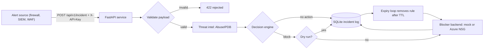

# SOAR Incident Response
# SOAR Incident Response

[](https://github.com/aquille-pl/soar-project/actions/workflows/ci.yml)

A small Security Orchestration, Automation, and Response (SOAR) service. It receives security alerts over a webhook, checks the offending IP against a threat-intelligence source, decides whether to act, and can automatically block the IP with a deny rule in an Azure Network Security Group. Blocks expire on their own, and every incident and action is logged.

It was built as a lab project to move from network and systems administration toward security and cloud engineering: the network mitigation I already knew (ACLs, firewall blocks) turned into an automated, tested software service.

## How it works



1. **Receive.** `POST /api/v1/incident` accepts an alert (source IP, alert type, severity). The request must carry a valid `X-API-Key`.
2. **Validate.** Pydantic rejects malformed input (for example, an invalid IP) before any logic runs.
3. **Enrich.** Public IPs are looked up on AbuseIPDB for an abuse confidence score. Private, loopback, and reserved addresses are never looked up or blocked.
4. **Decide.** The IP is blocked only if it is not allowlisted and its score meets the threshold. If the lookup fails, the decision is "no action".
5. **Act.** In dry-run mode the action is only logged. Otherwise the configured backend runs: a mock, or an Azure NSG inbound **Deny** rule at a reserved priority.
6. **Record and expire.** Every incident and block is stored in SQLite. A background loop removes each block when its TTL runs out, using the backend that created it.

## Design decisions

- **Fail safe.** When unsure (API down, missing key, private address), the service does nothing rather than block.
- **Dry run by default.** Nothing changes in a firewall until `DRY_RUN=false` is set deliberately.
- **Least privilege.** The service runs as an Azure service principal with a custom role that can read one NSG and create or delete its security rules, and nothing else.
- **Defense in depth.** The Azure backend refuses non-public IPs even if the decision layer is bypassed.
- **Idempotent blocks.** Rule names derive from the IP, so repeated alerts don't create duplicate rules.
- **Auth fails closed.** If no webhook secret is configured, every request is rejected. Keys are compared in constant time.
- **Pluggable backends.** The decision logic talks to a small `block` / `unblock` interface, so another backend (AWS, an on-prem firewall) can be added without touching it.
- **No secrets in code or images.** Secrets live in `.env`, which is git-ignored and excluded from the Docker image.

## Quick start

Requires Python 3.13+.

```bash
git clone https://github.com/aquille-pl/soar-project.git
cd soar-project
python3 -m venv .venv && source .venv/bin/activate
pip install -r requirements.txt
cp .env.example .env     # then fill in ABUSEIPDB_API_KEY and WEBHOOK_SECRET
uvicorn app.main:app --reload
```

Send a test alert:

```bash
curl -X POST http://127.0.0.1:8000/api/v1/incident \
  -H "X-API-Key: $WEBHOOK_SECRET" \
  -H "Content-Type: application/json" \
  -d '{"source_ip": "8.8.8.8", "alert_type": "port_scan", "severity": "high"}'
```

Interactive API docs are at `http://127.0.0.1:8000/docs`.

### Docker

```bash
docker build -t soar-project .
docker run --rm -p 127.0.0.1:8000:8000 --env-file .env -v soar-data:/data soar-project
```

## API

All endpoints require the `X-API-Key` header.

| Method | Path | Purpose |
|---|---|---|
| POST | `/api/v1/incident` | Submit an alert; runs the full pipeline |
| GET | `/api/v1/incidents` | List stored incidents, newest first |
| GET | `/api/v1/blocks` | List blocks and their status (`active`, `expired`, `manually_unblocked`) |
| POST | `/api/v1/unblock` | Remove a block manually |

## Configuration

| Variable | Default | Purpose |
|---|---|---|
| `WEBHOOK_SECRET` | none (required) | Shared secret for the `X-API-Key` header |
| `ABUSEIPDB_API_KEY` | none | Threat-intelligence lookups |
| `BLOCKER` | `mock` | `mock` or `azure_nsg` |
| `DRY_RUN` | `true` | Log actions without performing them |
| `BLOCK_THRESHOLD` | `75` | Minimum abuse score to block |
| `BLOCK_TTL_MINUTES` | `1440` | How long a block lasts |
| `ALLOWLIST` | empty | Comma-separated IPs or CIDRs that are never blocked |
| `SOAR_DB_PATH` | `incidents.db` | SQLite file location |
| `AZURE_*` | none | Tenant, client ID and secret, subscription, resource group, NSG name |

## Azure setup (for the `azure_nsg` backend)

Create a resource group, a virtual network, and an NSG, then a service principal scoped to that NSG only, using a custom role such as:

```json
{
  "Name": "SOAR NSG Rule Manager",
  "Actions": [
    "Microsoft.Network/networkSecurityGroups/read",
    "Microsoft.Network/networkSecurityGroups/securityRules/read",
    "Microsoft.Network/networkSecurityGroups/securityRules/write",
    "Microsoft.Network/networkSecurityGroups/securityRules/delete"
  ]
}
```

## Testing and CI

```bash
pytest -v
```

The tests cover the decision rules, authentication, input validation, the incident flow, block expiry, and the Azure backend's safety checks. External services are faked, so the suite never touches the internet, Azure, or a real database.

GitHub Actions runs on every push: `ruff` lint, `pytest`, a `pip-audit` dependency vulnerability scan, and a Docker image build.

## Known limitations

- Authentication is a shared secret over plain HTTP. For production you would add TLS and signed requests (HMAC plus a timestamp) to prevent replay.
- No rate limiting on the webhook.
- A single threat-intelligence source, so scores can produce false positives or negatives.
- SQLite and an in-process expiry loop suit one instance, not a scaled-out deployment.
- NSG rule priorities are allocated without locking, so two simultaneous blocks could collide.
- Blocks are inbound-only and apply to all ports and protocols.

## Roadmap

- Add VirusTotal and combine verdicts.
- Signed webhooks (HMAC) and rate limiting.
- Accept Microsoft Sentinel alert payloads.
- Identity response: revoke a compromised user's sessions through Microsoft Graph.
- Additional backends (AWS Network ACLs).